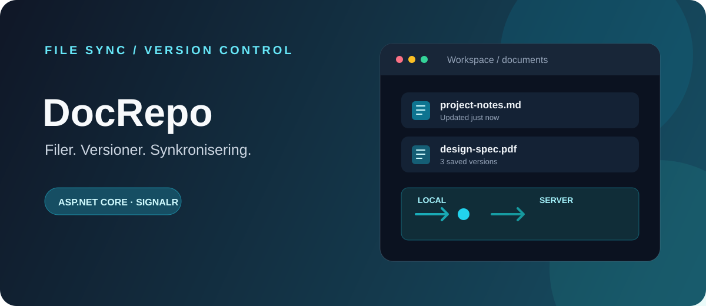
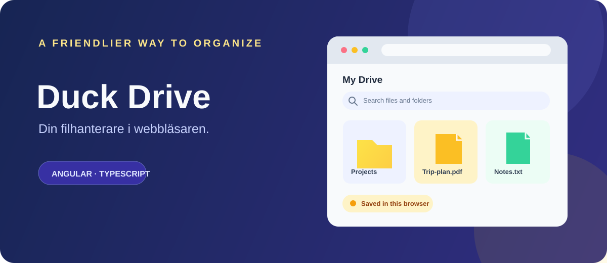
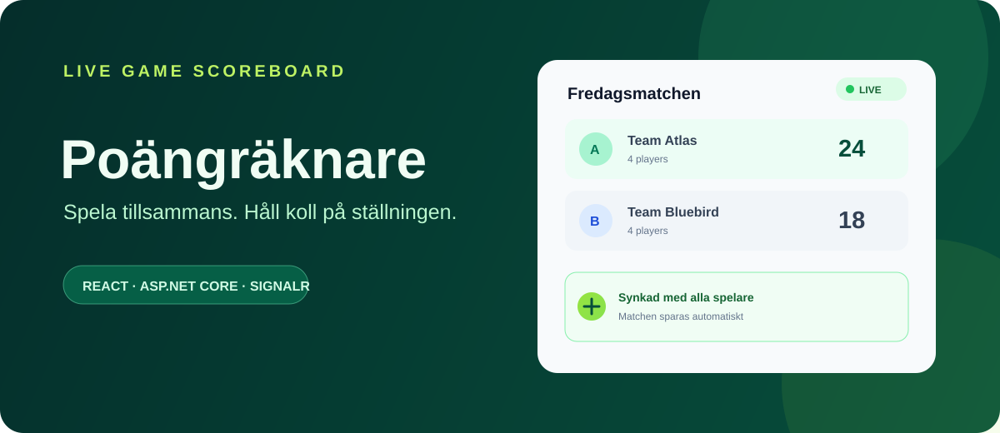
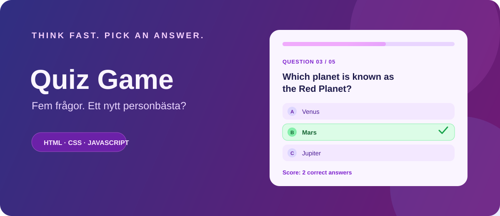
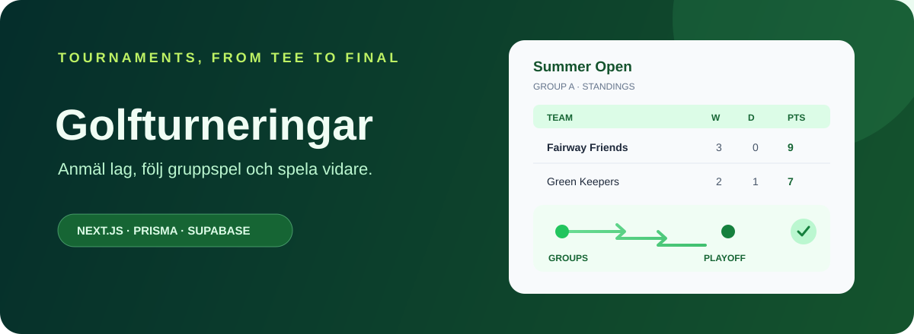

# Johan Norgren

**Blivande systemutvecklare · .NET · webbutveckling · AI**

Jag studerar systemutveckling med .NET och bygger projekt för att lära mig mer om hela kedjan – från gränssnitt och affärslogik till databaser och API:er.

[Projekt på GitHub](https://github.com/Johan24-prog?tab=repositories) ·
[LinkedIn](https://www.linkedin.com/in/johan-norgren/) ·
[Utbildning](https://edugrade.com/yh-utbildning-och-nationell-yrkesutbildning/program/systemutvecklarenet-med-ai-kompetens/)

## Utvalda projekt

<table>
<tr>
<td width="50%" valign="top">

### [DocRepo](https://github.com/Johan24-prog/kurs-4-asp-net)

Fil- och versionshantering med webbgränssnitt, REST API och klient för synkronisering.

**Teknik:** C#, .NET 10, ASP.NET Core, EF Core, SQLite, SignalR

</td>
<td width="50%" valign="top">

### [Duck Drive](https://github.com/Johan24-prog/kurs-2-ramverk-angular-grupp)

Frontendprototyp för filhantering med sök, mappar och papperskorg. Data sparas lokalt i webbläsaren.

**Teknik:** Angular 21, TypeScript, HTML, SCSS

</td>
</tr>
<tr>
<td width="50%" valign="top">

### [Poängräknare](https://github.com/Johan24-prog/kurs-4-po-ngr-kningsapp-grupp)

Skapa matcher, hantera spelare och följ poängen. Matchändringar synkas i realtid.

**Teknik:** React, TypeScript, Vite, Tailwind CSS, ASP.NET Core, EF Core, SQLite, SignalR

</td>
<td width="50%" valign="top">

### [Quiz Game](https://github.com/Johan24-prog/Quiz-Game)

Ett webbaserat frågespel med flervalsfrågor, poängräkning och resultatsida.

**Teknik:** HTML, CSS, JavaScript

</td>
</tr>
</table>

### Pågående: Golfturneringar

En webbapp för turneringar med laganmälningar, gruppställning och slutspel. Projektet är under utveckling.

**Teknik:** Next.js, React, TypeScript, Prisma, Supabase, PostgreSQL, Tailwind CSS

## Teknik och verktyg

**Språk:** C#, TypeScript, JavaScript, HTML, CSS 
**Backend och data:** .NET, ASP.NET Core, Entity Framework Core, Prisma, SQLite, PostgreSQL 
**Frontend:** Angular, React, Next.js, Vite, Tailwind CSS, SCSS 
**Övrigt:** SignalR, Git, GitHub, Visual Studio, VS Code

## Kontakt

Jag är intresserad av att fortsätta utvecklas inom systemutveckling och bygga användbara, välstrukturerade applikationer.

[GitHub](https://github.com/Johan24-prog) · [LinkedIn](https://www.linkedin.com/in/johan-norgren/)
